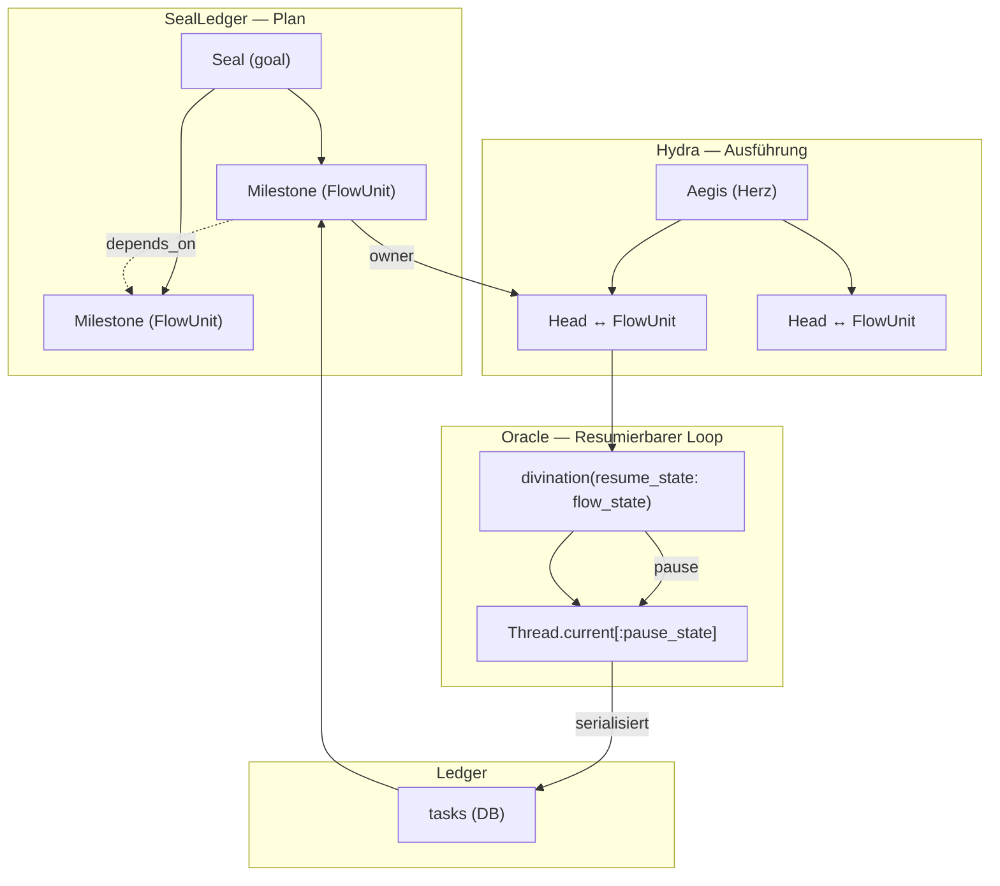

# Concurrent-Flow Vereinigung — Skizze & Implementierungsplan

> **Status:** Plan-Dokument (Skizze). Keine Concurrent-Programmierung wird jetzt begonnen.
> **Zweck:** Bevor ein einziger Thread mehr gesponnen wird, wird die Vereinigung des
> fragmentierten „Fluss-Modells" auf Papier festgehalten — als Grundlage für die
> spätere, inkrementelle Implementierung.

---

## 0. Kurzfassung

Das „Concurrent-Flow-Modell" existiert bereits, aber **fragmentiert über fünf Schichten**.
Jede Schicht besitzt ein eigenes Stück des Puzzles — Resumierbarkeit, Nebenläufigkeit,
Zustandsmaschine, Persistenz, Orchestrierung — aber es gibt **keine gemeinsame Abstraktion
einer „resumierbaren, nebenläufigen Arbeitseinheit"**, auf die alle fünf konvergieren.

Dieses Dokument definiert (1) die Diagnose, (2) das Zielbild, (3) die Kernabstraktion,
(4) das Konvergenz-Mapping und (5) einen **inkrementellen Phasenplan**, der die Vereinigung
ohne Big-Bang-Rewrite erreicht. Die tatsächliche Nebenläufigkeits-Arbeit ist **ab Phase 3**
angesiedelt und wird bewusst zurückgestellt.

---

## 1. Diagnose: das fragmentierte Modell

Fünf Orte besitzen heute je eine Teilwahrheit des Flusses:

| # | Schicht | Datei | Besitzt | Lücke |
|---|---------|-------|---------|-------|
| 1 | **Oracle** (Turn-Loop) | `ruby/oracle/oracle.rb` | Resumierbare Turn-State (`resume_state:` Param, `Thread.current[:pause_state]`, kooperativer Pause-Check) | Keine eigene Nebenläufigkeit, kein Lifecycle, keine Persistenz |
| 2 | **Hydra** (Multiplexer) | `ruby/oracle/hydra.rb` | Köpfe (`Head`) + Worker-Threads + kooperatives Pause/Resume | Eigener, handgerollter Scheduler; State nur thread-lokal + am `Head` |
| 3 | **MagnumOpusEngine** (Task/Step) | `ruby/magnum_opus/magnum_opus_engine.rb` | Zustandsmaschine (`STATES`), rekursive Step-Schleife, Retry | Sequentielle Ausführung; `paused` ist nur DB-Flag, **nicht** resumierbar |
| 4 | **TaskLedger** | `ruby/mnemosyne/task_ledger.rb` | Persistenz/CRUD für Tasks (+ Subtask-Bookkeeping) | Nur CRUD, keine Ausführungslogik |
| 5 | **SealLedger** | `ruby/mnemosyne/seal_ledger.rb` | Orchestrierung: Seals → Milestones, `depends_on`-Kanten, `owner` | Kein eigener Fluss; delegiert an TaskLedger/Engine |

### Die präzisen Nahtstellen (Beleg)

1. **Oracle — resumierbare Turn-State:**
   - `divination(..., resume_state: nil, &exec)` (`oracle.rb:113`) nimmt einen State-Hash
     `{ messages:, tool_results:, arts:, answer: }` entgegen und setzt ihn als Startpunkt.
   - Vor dem ersten API-Call (`oracle.rb:161`) und vor jedem Loop-Schritt (`oracle.rb:220`)
     wird `Thread.current[:pause_state]` mit demselben Hash beschrieben.
   - Kooperativer Abbruch: `Thread.current[:paused]` wird vor jedem API-Call geprüft
     (`oracle.rb:228`) → Rückgabe `{ __divine_interrupt: true, __reason: :paused }`.

2. **Hydra — Nebenläufigkeit + Resume:**
   - `Head` (`hydra.rb:126`) trägt `pause_state`, `worker` (Thread), `busy`, `history`.
   - `new_head_worker` (`hydra.rb:529`) startet `Oracle.divination(..., resume_state: head.pause_state)`
     im Hintergrund-Thread und hält nach Pause `Thread.current[:pause_state]` am Kopf fest.
   - `pause_head` (`hydra.rb:580`) setzt `worker[:paused] = true` (cross-thread Flag);
     `resume_head` (`hydra.rb:587`) re-spawnt den Worker mit dem gehaltenen State.

3. **MagnumOpus — Zustandsmaschine (ohne echtes Resume):**
   - `STATES = %i[pending active paused failed completed invalid cancelled]` (`magnum_opus_engine.rb:619`).
   - `execute_task` (`:1080`) → `execute_task_internal` (`:1959`) → rekursive `execute_step`-Schleife.
   - `execute_sub_tasks` (`:971`) läuft **sequentiell**; der Kommentar sagt selbst:
     „future: parallel agent dispatch via thread pool".

4. **Ledger — Persistenz (nur CRUD):**
   - `TaskLedger` (`task_ledger.rb:9`): `create_task`/`get_task`/`update_task`/`manage_tasks`/Subtask-Bookkeeping.
   - `SealLedger` (`seal_ledger.rb:13`): `create_seal` → `create_milestone` (via `TaskLedger.manage_tasks`),
     `seal_status` berechnet `next`/`blocked` über `depends_on`, `seal_run` treibt den kritischen Pfad.

### Kernproblem in einem Satz

> Es gibt **eine** Resumierbarkeits-Primitive (Oracle), **einen** Nebenläufigkeits-Scheduler (Hydra),
> **eine** Zustandsmaschine (MagnumOpus) und **eine** Persistenz/Orchestrierung (Ledger) —
> aber **kein gemeinsames „FlowUnit"-Objekt**, das alle vier Aspekte einer einzelnen
> Arbeitseinheit in sich trägt.

---

## 2. Zielbild

Eine einzige Abstraktion — Arbeitstitel **`FlowUnit`** (Kopf/Ouroboros-Knoten) — die
eine **resumierbare, nebenläufige Arbeitseinheit** vollständig beschreibt:

- **Identität** (`id`) — stabil über Pause/Resume/Neustart hinweg.
- **Lifecycle** (`state`) — *eine* Zustandsmaschine statt drei (MagnumOpus `STATES`,
  Hydra `busy`/`paused`-Flags, Oracle `:paused`-Signal).
- **Turn-State** (`flow_state`) — der resumierbare Hash `{ messages:, tool_results:, arts:, answer: }`,
  als First-Class-Value-Object statt als ad-hoc Hash + thread-lokalem Slot.
- **Scheduler-Bindung** (`binding`) — Verweis auf den ausführenden Thread/Kopf, plus kooperative Flags.
- **Persistenz-Handle** (`ledger_row`) — der Task-/Milestone-Eintrag, in den der State serialisiert wird.
- **Orchestrierung** (`edges`) — `depends_on` + `owner`, damit Seals denselben Knoten steuern können.



**Ziel-Invariante:** Jede laufende Arbeit ist *genau ein* `FlowUnit`, dessen Zustand an
**einer** Stelle lebt und von Oracle (Turn), Hydra (Scheduler), MagnumOpus (Lifecycle),
TaskLedger (Persistenz) und SealLedger (Orchestrierung) **gemeinsam** gelesen/geschrieben wird —
statt fünf getrennter Wahrheiten.

---

## 3. Kernabstraktion (Vertrag, noch kein Code)

### 3.1 `FlowState` — der resumierbare Turn-State als Value-Object

Ersetzt den ad-hoc Hash `{ messages:, tool_results:, arts:, answer: }` und den
thread-lokalen Slot `Thread.current[:pause_state]` durch eine benannte Struktur:

```
FlowState
  messages       # Nachrichtenverlauf (resumierbar)
  tool_results   # Tool-Ergebnisse des Turns
  arts           # Nebenprodukte (prelude, timing, reasoning …)
  answer         # bisherige Antwort (nil bis zur Vollendung)
  depth          # Loop-Tiefe (damit Resume nicht bei Schritt 0 neu zählt)
  reason         # :paused | :completed | :error  (warum der State eingefroren wurde)
```

- **Serializer** (`pack`/`unpack`) — verlustfrei nach JSON/DB (nur der fachliche Kern;
  Streams, Sinks und Thread-Handles gehören **nicht** hinein).
- **Unveränderlich pro Schritt** — der Loop beschreibt eine neue Version statt den
  gleichen Hash zu mutieren (vereinfacht Resume-Audit + Persistenz).

### 3.2 `FlowUnit` — die Arbeitseinheit

```
FlowUnit
  id            # stabil, über Prozesse hinweg (DB-PK)
  state         # :pending :active :paused :failed :completed :cancelled  (EINE Maschine)
  flow_state    # FlowState (resumierbarer Kern)
  binding       # Scheduler-Bindung: Thread/Kopf-Referenz + kooperative Flags (:paused)
  ledger_row    # Task-/Milestone-Zeile (Persistenz-Handle)
  edges         # depends_on[], owner
```

### 3.3 Konvergente Primitive (benannt, damit alle Schichten dieselbe Sprache sprechen)

| Primitive | Heute | Morgen (eine Quelle) |
|-----------|-------|----------------------|
| `pause(unit)` | `pause_head` setzt `worker[:paused]` | `unit.binding[:paused] = true` → kooperativer Check in `divination` |
| `resume(unit)` | `resume_head` re-spawnt Worker | `divination(resume_state: unit.flow_state.pack)` |
| `state(unit)` | `STATES` + `busy` + `:paused`-Signal | `unit.state` (eine Maschine) |
| `persist(unit)` | manuell `manage_tasks` | `unit.ledger_row.write(unit.flow_state.pack)` |
| `dispatch(unit)` | `spawn_worker` / sequentielle Subtasks | Scheduler bindet `unit` an einen Worker |

---

## 4. Konvergenz-Mapping (5 → 1)

| Bestand | Rolle im Ziel | Was sich ändert |
|---------|---------------|-----------------|
| **Oracle.divination** | Turn-Primitive | Akzeptiert `FlowState` statt Hash; liest/schreibt `FlowUnit.state`; `Thread.current[:pause_state]` wird zu `unit.flow_state` (kein neuer globaler Slot) |
| **Hydra** | Scheduler | `Head` wird zu einer Sicht auf `FlowUnit` (oder trägt genau ein `FlowUnit`); `pause_head`/`resume_head` delegieren an `unit.pause`/`unit.resume` |
| **MagnumOpusEngine** | Lifecycle | `execute_task_internal`/`execute_step` betreiben `FlowUnit`; `paused` wird resumierbar (State-Persistenz statt bloßem DB-Flag); `execute_sub_tasks` kann später parallel dispatcht werden |
| **TaskLedger** | Persistenz | Bleibt CRUD, lernt aber `FlowState`-Spalten (oder eine `flow_states`-Tabelle) zu schreiben/lesen |
| **SealLedger** | Orchestrierung | Milestones **sind** `FlowUnit`s; `seal_run` treibt den kritischen Pfad über `edges` |

> **Kein Rewrite:** Die bestehenden Klassen bleiben erhalten; die Vereinigung passiert über
> eine gemeinsame Datenstruktur + gemeinsame Primitive, nicht über eine neue Monolith-Klasse.

---

## 5. Phasenplan (inkrementell, Nebenläufigkeit bewusst hinten)

> Konvention: Jede Phase ist **für sich** mergebar und lässt das System lauffähig.
> Die Spalte „Concurrency?" markiert, wo tatsächliche Nebenläufigkeits-Arbeit beginnt.

### Phase 0 — `FlowState` als First-Class-Value-Object *(keine Nebenläufigkeit)*
- `FlowState`-Struct mit `pack`/`unpack` einführen.
- `Oracle.divination` intern darauf umstellen (Parameter bleibt vorerst Hash-kompatibel).
- **Ergebnis:** Ein einziger, benannter, serialisierbarer Turn-State statt ad-hoc Hash + thread-lokalem Slot.
- **Concurrency?** Nein — reine Typen-Extraktion.

### Phase 1 — Eine Zustandsmaschine *(keine Nebenläufigkeit)*
- `FlowUnit.state` als **eine** Maschine einführen (`pending → active → paused/failed/completed → cancelled`).
- MagnumOpus `STATES` als Referenz nutzen; Hydra-`busy`/`paused` als *Projektion* auf `unit.state`.
- **Ergebnis:** `paused` bedeutet überall dasselbe — resumierbar, nicht bloß ein DB-Flag.
- **Concurrency?** Nein — reine Zustands-Semantik.

### Phase 2 — Persistenz des FlowState *(keine Nebenläufigkeit)*
- `TaskLedger` um FlowState-Spalten (oder `flow_states`-Tabelle) erweitern.
- `persist(unit)` schreibt `flow_state.pack`; `resume` liest ihn zurück.
- **Ergebnis:** Ein Task überlebt Prozess-Neustarts *mitten im Turn*.
- **Concurrency?** Nein — reine Persistenz.

### Phase 3 — Scheduler-Konvergenz *(Concurrency beginnt hier — zurückgestellt)*
- Hydra-`Head` auf `FlowUnit` umstellen; `pause`/`resume` über die unit-Primitive.
- MagnumOpus `execute_sub_tasks` von sequentiell auf parallel (Thread-Pool über dieselben `FlowUnit`s).
- **Ergebnis:** EINE Scheduler-Semantik für Hydra-Köpfe **und** Task-Subtasks.
- **Concurrency?** **Ja** — dies ist die eigentliche Concurrent-Arbeit.

### Phase 4 — Orchestrierung auf den FlowUnits *(nach Phase 3)*
- `SealLedger`-Milestones als `FlowUnit`s; `seal_run` steuert den kritischen Pfad über `edges`.
- Nebenläufige Milestones (parallele `depends_on`-Blöcke) werden erst jetzt möglich.
- **Concurrency?** Ja (Folge von Phase 3).

### Phase 5 — Aufräumen / Rückbau
- `Thread.current[:pause_state]`-Slot entfernen (durch `unit.flow_state` ersetzt).
- Veraltete `busy`/`paused`-Doppelbuchführung konsolidieren.
- **Concurrency?** Nein — Aufräumen.

---

## 6. Offene Entscheidungspunkte (vor Implementierung zu klären)

1. **Name der Abstraktion:** `FlowUnit` vs. `Ouroboros-Knoten` vs. `Aegis-Kopf`?
   (Hinweis: `Ouroboros` ist als Memory-Synthese bereits belegt — `ruby/mnemosyne/ouroboros.rb`.)
2. **Persistenz-Form:** FlowState in die `tasks`-Tabelle (Spalten) vs. eigene `flow_states`-Tabelle (1:N-Historie)?
3. **Granularität des Resume:** Auf Turn-Ebene (heutiger Oracle-Stand) oder auf Step-Ebene (MagnumOpus)?
4. **Scheduler-Modell:** Ein globaler Thread-Pool für Hydra **und** Subtasks, oder getrennte Pools?
5. **`Head`-Verhältnis:** Ist `Head` ein Wrapper **um** ein `FlowUnit`, oder **ist** ein `Head` ein `FlowUnit`?

---

## 7. Non-Goals (was jetzt bewusst **nicht** passiert)

- **Keine Concurrent-Programmierung** (Phase 3+ zurückgestellt).
- Kein Big-Bang-Rewrite von `hydra.rb` oder `magnum_opus_engine.rb`.
- Keine neue Monolith-Klasse, die die fünf Schichten ersetzt.
- Kein API-/Verhaltensbruch für Bestandsnutzer (Chamber, Seals, Tasks, Hydra).
